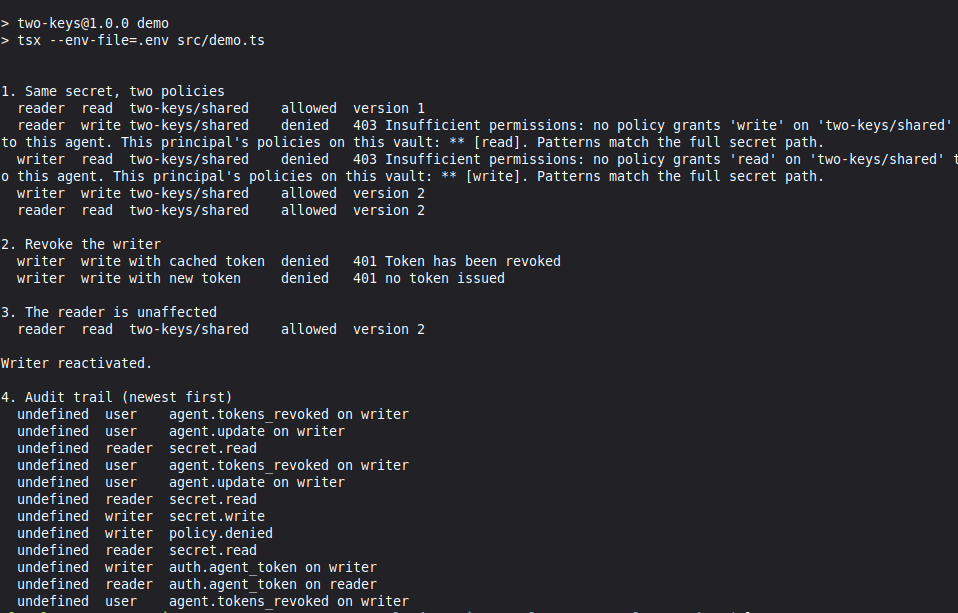

# two-keys

Two AI agents, each with its own [1Claw](https://1claw.co) identity, aimed at the same secret. One can only read it. One can only write it. Then the writer is revoked, and the reader carries on.

## How 1Claw is used

| Feature | File | 1Claw endpoint or tool |
|---|---|---|
| A separate identity per agent (`ocv_` key exchanged for a short-lived token) | `src/oneclaw.ts` | `POST /v1/auth/agent-token`, `GET /v1/agents/me` |
| One path-scoped policy per agent (`read` only vs `write` only) | `scripts/setup.ts` | `GET`/`POST /v1/vaults/:id/policies` |
| Agents pinned to one vault, 300 s token lifetime, Intents and Shroud off | `scripts/setup.ts` | `PATCH /v1/agents/:id` |
| The secret read and written just in time, its value never printed | `src/run.ts` | `GET`/`PUT /v1/vaults/:id/secrets/*path` |
| Revoke one agent, then restore it | `src/run.ts` | `PATCH /v1/agents/:id` `{is_active}` |
| Step-up auth with an authenticator code for sensitive changes | `src/oneclaw.ts` | `POST /v1/auth/reauth/complete`, `X-Auth-Confirm` |
| Who did what | `src/run.ts` | `GET /v1/audit/events` |
| Your editor's agent reaches the vault, read-only | setup step 4 | `@1claw/mcp` via `@1claw/cli setup` |

## Demo



A real run. The `undefined` in the audit trail was a timestamp bug in this capture, fixed since.

## What the demo checks

| Call | reader | writer |
|---|---|---|
| read `two-keys/shared` | allowed | denied |
| write `two-keys/shared` | denied | allowed |
| writer revoked: cached token and new token | still reads | write denied |

Any other outcome makes the demo exit with an error. Only 401 and 403 count as "denied", so an outage is not mistaken for a policy.

## Setup

You need Node.js 22+ and a 1Claw account with room for one vault and two agents. Turn on two-factor authentication (an authenticator app): when 1Claw asks to confirm a change, the scripts prompt for its 6-digit code, so run them in an interactive terminal.

1. In the [1Claw dashboard](https://1claw.co), create an empty vault for this demo and two agents with API key auth, one to read and one to write. Each key is shown once. Remove any other policy the agents have on the new vault.
2. Install and configure:
   ```bash
   npm install
   cp .env.example .env && chmod 600 .env
   ```
   Fill in `.env`: your personal `1ck_` key, the new vault's ID, and the two agent keys.
3. Create the demo secret and the two policies (`**` on this vault: `read` for one agent, `write` for the other), and tighten both agents. Safe to re-run.
   ```bash
   npm run setup
   ```
4. Optional: give your editor's agent the **read-only** identity.
   ```bash
   grep '^ONECLAW_READER_KEY=' .env | cut -d= -f2- | npx @1claw/cli setup --client claude-code --agent-key -
   ```
   For Claude Code this writes a user-wide MCP entry: it replaces any existing `1claw` entry and stores the key in your Claude config.
5. Run it:
   ```bash
   npm run demo
   ```

The demo reactivates the writer when it finishes, including after an error. If you kill it halfway, reactivate the writer in the dashboard.

## Tests

```bash
npm test            # 1Claw is faked, no network
npm run typecheck
npm run smoke       # one read against the live API
```

## Security notes

- `.env` is gitignored. It holds your human key, so treat it with care.
- The agents cannot revoke or reactivate anyone. The demo uses your human key for that.

## License

MIT
